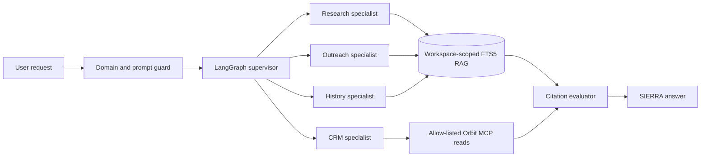
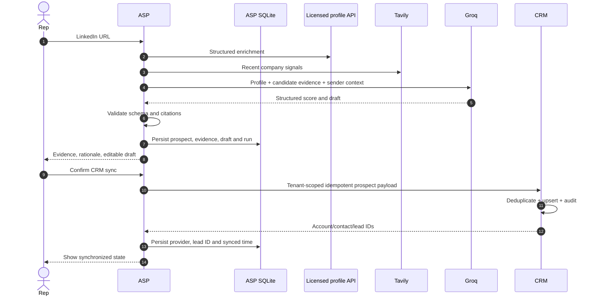

# Prospecting flow

## SIERRA agent and retrieval flow

Only validated evidence is indexed. Retrieval is scoped to the authenticated workspace and returns source URLs. The evaluator rejects unsupported results before display; CRM writes still require an explicit authenticated sync action.

## What appears in each application

| Data | ASP | Orbit CRM |
| --- | --- | --- |
| Prospect identity | Research history | Contact |
| Company | Research result | Account |
| Evidence and URLs | Evidence panel | Research activities |
| Outreach copy | Editable draft | Agent/sequence context after review |
| Sync result | Provider, time, Orbit lead ID | Account/contact/lead IDs and integration heartbeat |
| Sales lifecycle | Not owned by ASP | Lead, opportunity, pipeline, activities and approvals |

Trust boundaries:

1. Provider output is untrusted and schema-validated.
2. Retrieved text may contain prompt injection; it is evidence, never an instruction.
3. The model proposes content but cannot bypass deterministic validation or confirmation.
4. The CRM shared secret authenticates the service, while `CRM_ORGANIZATION_ID` selects the tenant; both must be protected.

